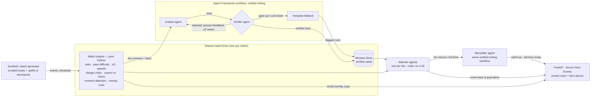

# COMEBACK

**An AI match insights engine for studio and streaming that personalizes on what each fan
saw, or missed.**

### You left the match. COMEBACK didn't.

Today fans check the score every five minutes and are present nowhere: not at their
kid's match, not in front of the game. COMEBACK reads every event of the match live,
explains why moments matter, and personalizes them for each fan (language, side, level,
favourite player, one metric). Step away, and it calls you back **before** the big
moment, with the reason; come back, and it replays what you missed and tells you what
changed. **Put your phone away. COMEBACK will tell you when it matters.**

- **54% of goals announced in advance**, 1.6× better than the same number of random
  alerts, on 50 unseen matches, with a **median warning of 60 s**. We announce big
  moments; we do not claim to predict goals.
- **Verified text**: every number and name is checked before a fan sees it. A single
  LLM agent doing everything delivers a factual problem in 12% of its texts; COMEBACK in 0.
- **One brain for every fan**: serving **200,000** simulated fans takes about
  **1,900** LLM calls instead of more than 600,000 (≈ $0.61 instead of ≈ $805).

> *The future of football isn't more screens. It's a match that fits your life.*

**▶ Live demo: [comeback.lemonforest-f9ddbdf8.switzerlandnorth.azurecontainerapps.io](https://comeback.lemonforest-f9ddbdf8.switzerlandnorth.azurecontainerapps.io)** (Azure Container Apps; the first load can take ~20 s while it wakes up)

[](https://codespaces.new/imaneoujja/comeback)


> Built for *Inside the Game: Developer Hackathon* (Microsoft × Premier League),
> challenge "Synthetic Match Insights Engine". All data is **synthetic**; all
> clubs and players are **fictional**.

---

## What it does

| | What happens | In the demo match |
|---|---|---|
| **1. You leave** | A Watcher agent keeps watching for you, under your own rules (goal threats, equaliser or winner only, any big moment; night mode). It knows your club, favourite player, level and language. | Omar (Emberfield fan, analyst, French) goes pitchside for a kids' match next door at 63'. |
| **2. It's heating up** | It calls you back **before** the moment, and says why. Your phone takes over the screen, rings, and reads the reason aloud. | 65' and 69': *"Reviens — Emberfield est entré 3 fois dans la surface en 2 minutes et a tenté 1 tir."* |
| **3. You return** | Spoiler-free: if a goal happened, your phone only said "something big happened"; the score waits for your replay. The TV rewinds: the moments you missed are replayed in 3D from behind the goal while a neural voice reads your "Previously on…" catch-up of what **changed**, sized to your absence. A live goal cuts the replay short. | 70': a catch-up in French, then the 71' goal, seen live. The phone confirms: *"COMEBACK l'avait senti : alerte à la 69e, but à la 71e."* |
| **4. Full-time** | Your own front page: the match told from your side. | Sofia (Comets fan): *"Heartbreaking loss for Saltmarsh Comets after strong start"*. |

Around this loop sits a **broadcast control room**: a 3D program feed with
broadcast graphics (player tags, pass difficulty, shot speed, speed and distance
tags, danger index), an AGENTS monitor showing the agents at work, a simulated
audience of 10,000 fans, and **timed, machine-readable overlay cues** a broadcast
graphics renderer could consume.

## Why not just stream it on your phone?

Because a stream, or a commentary turned up loud, asks for 90 minutes of attention, and
COMEBACK is built for the moments when you have none to give: on the touchline at your
kid's match (our main case), on a work call, putting the kids to bed, or asleep through a
4 a.m. kick-off in another time zone (night mode: "wake me only if…"). Your phone is in
your pocket, face down. It is not COMEBACK's competitor; it is its channel: one buzz, one
sentence with the reason, at the right time, at most twice per absence, opt-in and under
your rules. And when you are back, the stream does not tell you what changed. COMEBACK
does, in your language and from your side.

**For broadcasters and the official app (B2B2C):** COMEBACK is a layer they integrate, not
one more app. It does not pull viewers away from the live feed; it brings back fans who
had already left, before the peak moment, instead of sending a spoiler after it. In the
simulation, 882 of 10,000 fans were back in time for the 71' goal (assumption: 65% of
called fans return; a real figure needs an A/B test in production).

## Try it (zero configuration, no API key)

**Online:** open the [live demo](https://comeback.lemonforest-f9ddbdf8.switzerlandnorth.azurecontainerapps.io) in a desktop browser. Click **PAIR PHONE**
and scan the QR code with your phone: it becomes the fan's device, from anywhere.
The app scales to zero when nobody uses it, so the first request wakes it up.

**GitHub Codespaces:** click the badge above. The server starts by itself; open
the forwarded port **8000**.

**Locally** (Python ≥ 3.10):

```bash
git clone https://github.com/imaneoujja/comeback.git && cd comeback
python -m venv .venv && source .venv/bin/activate   # Windows: .venv\Scripts\activate
pip install -r requirements.txt
python -m comeback                                   # → http://localhost:8000
```

It runs **offline by default**, and what you see is live: on every visit the match
engine, the danger index, the Watchers, the Verifier and the simulated audience run
for real. Only the agents' texts for the two playable matches are cached
(`data/llm_cache.jsonl`, written once by Foundry), so you see real model output
without any key; a window we did not precompute gets a verified template instead.
**Try another match** (on the first screen) replays an unscripted fixture with the
same engine, Watchers and Verifier.

### What to try

1. **▶ Play the story** on the first screen (about 100 s, three acts, a caption per step and
   a pipeline strip INGEST → INTERPRET → EXPLAIN → RENDER → PERSONALIZE):
   - **Pitchside:** Omar (Emberfield fan, French, analyst) leaves at 63' for a kids' match.
     The TV is off but the engine keeps reading every event; the phone buzzes at 65' and
     69', each time with the Watcher's decision chain (events → state → insight → why Omar,
     why now).
   - **Living room:** back at 70': replay of what was missed with a neural voice, the 71'
     goal live, then the same moment as Omar, Sofia and Reda each got it.
   - **Backstage (STUDIO):** the agents and the timed overlay cues, a real Verifier catch at
     81', the LLM cut live (the 84' card still airs, from a verified template), the
     audience and the cost.
2. Or pick a fan and watch the match yourself:
   - **Omar**: press **SKIP TO 60'**, set your rules in **⚙ MY ALERT RULES** on the phone,
     then leave whenever you like (switch browser
     tab, or **I'M AWAY** on the on-screen phone), for example from 63' to 70'. The bar
     above the match suggests when a team is pushing.
   - **Sofia** (English, casual, Saltmarsh Comets fan): away at about 76', back at
     about 86'. Same match, a completely different story.
   - **Reda** (Spanish, follows striker Halen Merewood): joins at 60' and gets the
     story so far. The followed player carries a ★ label all match.
3. **STUDIO** (top right) opens the full control room: tactical camera, match data,
   the agents at work (drafts, Verifier rejections, revisions), a simulated audience
   of 10,000 fans and the cost curve.
4. Optional: **Use your real phone: PAIR** shows a QR code. Scan it, and the alerts
   ring and speak on your own phone.
5. Let it run to full-time: each fan gets their own front page.

## Related work

Others have already proved fans want this:

- **Prime Video Rapid Recap**: when you join an NBA or NFL game late, an AI recap
  of the key highlights you missed, before you rejoin the live action
  ([AWS](https://aws.amazon.com/solutions/amazon/one-amazon-lane/streaming)).
- **YouTube TV Key Plays**: catch up to live by jumping through a game's key plays
  ([Google support](https://support.google.com/youtubetv/answer/9119412?hl=en-GB)).
- **Turner Sports Excitement Alerts**: notifications when a game becomes close or
  turns into an upset ([Airship](https://www.airship.com/blog/turner-sports-ncaa-march-madness/)).

They show the need. But recaps wait for the fan to ask (or to join late), and
excitement alerts are about a whole game, for everyone. COMEBACK starts from the
fan's own attention: it notices that *you* left, calls *you* back *before* the
moment, from *your* club's side, and tells *you* what you missed. We don't claim
to be first; we combine these ideas around presence, at a cost that doesn't grow
with the audience.

## Presence signals

COMEBACK needs to know whether you are watching. All signals are opt-in, and it
uses no camera and no microphone.

| | Signals |
|---|---|
| **This demo** | Switching browser tab (Page Visibility API), the *I'm away / I'm back* buttons (on the screen or on the paired phone), joining a match in progress. |
| **In production** | The app going to the background, playback paused, inactivity on the player, and push notifications (APNs, FCM or Web Push) to bring the fan back. |

## How it works



### Agents, distinct roles, one shared state

| Agent | Input | Output | LLM? |
|---|---|---|---|
| **Analyst** | Compact computed facts of one key moment (never the raw event log), plus the match situation | Headline + "why it matters" (English, neutral), cited event ids | Yes |
| **Verifier** | A draft + the facts + the roster | Pass, or precise feedback for a retry | Rules (deterministic) |
| **Watcher** (one per fan) | The live danger index, the fan's presence and profile | "Come back" decision + reason, goal notifications, a "called it" receipt when a goal follows its call-back | No: instant and free per fan |
| **Storyteller** | The verified cards of the away window, a "what changed" delta, the fan profile | Catch-up or full-time recap in the fan's language, level and point of view | Yes |

- **Orchestration.** Analyst → Verifier → retry → fallback is a **Microsoft Agent
  Framework workflow** (`comeback/agents/workflow.py`) with typed executors and
  conditional edges. The *same* workflow serves the Storyteller. Every step is
  traced live on the AGENTS monitor.
- **Shared state and handoffs.** The engine and the Moment Store are written once
  and read by every Watcher and by the Storyteller. A moment gets a template card
  instantly, so nobody waits for the LLM; it is upgraded when the verified card lands.
- **Recovery from failure.** Rate limit (429), timeout, network error, budget
  exhausted, invalid JSON, or three rejected drafts: each ends with a
  deterministic, fact-based template flagged `source: "template"`. Tests force
  every path.
- **Failure drill, live.** In the STUDIO view, **⚡ CUT THE LLM** simulates an outage
  for your session only (`POST /api/session/{id}/outage`): every agent call fails
  as a real outage would, cards and catch-ups keep arriving as verified templates
  (amber badge), the stream never stops, and **RESTORE** brings the writers back.
- **Fact-checks on screen.** When the Verifier rejects a draft, the program feed
  shows it: the wrong words struck through, the Verifier's reason, then the version
  that went on air. In the demo, at 81' the Analyst gave the ten men "their
  numerical advantage"; the Verifier caught it and only the corrected card aired.


The STUDIO view shows the whole crew at work: tactical camera, engine data, the
agents' live log, the 10,000-fan audience and the rundown of verified cards.


## One match brain for every fan

The AUDIENCE monitor simulates 10,000 fans with random absences and late joins,
all served by the same engine and agents. Alert decisions are computed **once per
team**; a catch-up needs a new LLM story only when its (moments, language, level,
club, length) combination has never been written.

LLM calls needed to serve the whole demo match, by audience size (`/api/scale`):

| Fans | COMEBACK | One LLM call per catch-up |
|---|---|---|
| 1,000 | 699 | 3,058 |
| 10,000 | 1,260 | 31,317 |
| 50,000 | 1,578 | 157,433 |
| 200,000 | **1,854** | **628,386** |

These are cost figures on the scripted demo match. They say nothing about how
accurate the alerts are: that is measured separately, below. The audience is
simulated once per match and shared by every viewer of that match (not once per
visitor). "Fans back in time for the goal" (882 for the 71' goal) rests on a
**simulation assumption**: 65% of called fans return within two minutes. A real
figure needs an A/B test in production.

## Does "come back" actually predict anything?

**COMEBACK announces big moments; it does not predict goals.** We measure how often
its call-backs come true, with a fixed protocol (`scripts/evaluate_alerts.py`):

- **Matches:** unscripted synthetic matches only (random fixtures, no story beats). The
  scripted demo match is never used for these numbers; the script refuses it.
- **Tuning vs test:** the threshold was tuned on seeds 1001–1050 (to announce at least
  half of the goals) and is reported on **50 other, held-out matches** (seeds 2001–2050).
- **Precision:** an alert "comes true" if the same team has a shot with xG ≥ 0.1 within
  **90 s**. **Recall:** a goal is "announced" if an alert for the scoring team came in the
  previous **5 minutes** (the anticipation window). Lead time = goal time − last alert.
- **Chance baseline:** the **same number** of alerts placed at random instants (same
  teams), averaged over 20 random draws, scored with the same definitions.

| Held-out unscripted matches (129 goals) | COMEBACK | Same number of random alerts |
|---|---|---|
| Recall: goals announced within 5 min | **54%** (70/129) | 34% (**1.6×**) |
| Precision: alerts followed by a chance (xG ≥ 0.1) within 90 s | **21%** | 8% (**2.8×**) |
| False alerts per match (both teams) | 11.6 | 13.5 |
| Alerts per team per match | 7.3 | same |
| **Call-backs one fan actually receives per match** (simulated absences, max 2 per absence) | **1.9** | |
| Median warning before an announced goal | **60 s** | |
| Median time from an alert to the chance that follows | 16 s | |
| Decision latency (event → alert decision, compute) | p50 0.02 ms · p95 0.04 ms | |

Stricter or looser, at a glance (same held-out matches):


| Threshold | Recall | Precision | Alerts / team / match |
|---|---|---|---|
| 36 | 70% | 19% | 10.8 |
| **44 (default)** | **54%** | **21%** | **7.3** |
| 55 (night mode) | 32% | 23% | 3.2 |
| 65 | 9% | 30% | 0.8 |

Honest reading: most goals in our simulator come from short attacks, so many goals
are not preceded by sustained pressure, and most alerts are not followed by a goal.
That is why a fan receives at most two calls per absence, sets their own rules
(goal threats, equaliser or winner only, any big moment; night mode raises the bar
to 55 and calls once), and why every call states its reason instead of promising a
goal. Validated on synthetic data; real-data validation is future work. In the
scripted demo every goal is preceded by a call about the scoring team: that is a
design check of the story (a test), not a performance claim.

### The danger index, in the open

Every call-back cites the events that triggered it (the STUDIO **DECISIONS** monitor
shows the chain: events → state → insight → why this fan, why now).

| Ingredient (for the attacking team) | Weight |
|---|---|
| Pass or carry into the box | 8 |
| Shot | 10 + 40 × xG |
| Corner | 6 |
| Ball won in the opponent's half | 5 |
| Completed pass into the final third | 2 |
| Successful pressure | 2 |
| Completed pass in the opponent's half | 0.6 |

Each contribution decays exponentially (time constant 60 s; forgotten after 6 min), the
sum is squashed into 0–100 with `100 · tanh(sum / 55)` (`comeback/engine/danger.py`).
The alert rule (`comeback/engine/alerts.py`): danger ≥ 44 (night mode 55), rising by at
least 3 points over 30 s, not within 20 s of the team's own shot (that chance is over),
3-minute cooldown, at most 2 calls per absence (night mode 1).

### Latency and load

| Measured | Value |
|---|---|
| Danger → alert decision (engine update + rule, compute) | p50 0.02 ms · p95 0.04 ms |
| Alert decision → the fan's screen (server push over SSE, measured in the browser, localhost) | 10–13 ms |
| Alert → the chance it announced (median) / → the goal (median, when announced) | 16 s / 60 s |
| 10 simultaneous viewers, ×40 replay (`scripts/load_test.py`, local machine) | 0 errors · 13 events/s per viewer · API p50 5 ms, p95 9 ms |

The engine, the Watchers and the Verifier run live for every viewer; the 10,000-fan
audience is simulated once per match and shared, so a new viewer costs one replay loop.

### Reproduce the numbers

```bash
python scripts/evaluate_alerts.py                     # held-out table above (seeds 2001-2050)
python scripts/evaluate_alerts.py --first-seed 1001   # the tuning matches
python scripts/evaluate_alerts.py --curve             # threshold sweep + docs/alert_curve.svg
python scripts/compare_single_agent.py                # multi-agent vs one agent (offline, cached replies)
python scripts/load_test.py --viewers 10 --seconds 30 # needs a running server
python scripts/evaluate_texts.py                      # Foundry evaluations (needs a Foundry key)
curl localhost:8000/api/scale/demo-comeback           # LLM calls by audience size
```

## The Verifier earns its place

These are real errors from our recordings with `gpt-4.1-mini` (plus one our
tests caught). Each one became a rule:

| The model wrote | Why it was wrong | Rule now enforced |
|---|---|---|
| "Emberfield equalise *despite being a man down*" | Saltmarsh Comets had the red card | A "ten men" claim must name the short-handed team |
| "*the fastest shot of the season*" | The facts only cover this match | No season, league, career or all-time claims |
| "*The striker almost extended the lead* for Emberfield" | Emberfield were trailing 1-2 (the bare score "1-2" was misread) | Every score handed to the agents is labelled with team names |
| "Emberfield *grabbed a well-earned draw*" (at 86') | The match was not over | No final result (win, draw, defeat) before full-time, in all three languages |
| "Emberfield won, *overcoming a numerical advantage for Saltmarsh Comets*" | Saltmarsh Comets had 10 players | Numerical advantage or disadvantage claims must attach to the right team, including "for X", "against ten-man X" and "overcoming…" |
| "The striker scores his *9th*" (test case) | Invented: the 9 came from the player id `EMB-9` | Every number must exist in the facts; ids are not statistics |

The Verifier also rejects players who are not part of the moment, clubs outside
the match, and over-long texts.

### One agent, or a team of agents?

The principle: **LLMs where language is needed, deterministic code where truth is needed.**
To check that the split pays off, `scripts/compare_single_agent.py` gives ONE LLM agent the
same engine facts and the same instructions about names and numbers, and asks it to write
every moment card and a fan's catch-up in one call (no verification), for 3 fans on the demo
match and 2 unscripted matches. It only sees what had happened when the fan came back. Every
text is then checked with the Verifier's rules.

| | One LLM agent does everything | COMEBACK (Analyst → Verifier → Storyteller, shared brain) |
|---|---|---|
| Texts with a factual problem delivered to fans | **7 / 57 (12%)** | **0 / 57** (1 template fallback) |
| Key moments left without a card | 47 of 95 | 0: a template card at once, the verified text when ready |
| What went wrong / what was caught | player or club not in the facts 5, invented or wrong number 4, result announced before full time 2 | caught before air: numerical advantage on the wrong team 5, wrong number 3, player not in the facts 3, early result 1 |
| LLM calls for 200,000 fans (demo match) | 628,369 (one per catch-up) | **1,854** (cards once, stories shared) |
| Cost for 200,000 fans (gpt-4.1-mini list price) | ≈ $805 | **≈ $0.61** |
| Latency | ≈ 3.9 s per fan, only after the absence | template card instantly; verified card ≈ 1.7 s (median call) |

Replies are cached in `data/experiments/compare_cache.jsonl`, so the table replays offline.
The single agent is not a strawman: same model, same facts, same rules in its
instructions; it simply has nobody to check it and no shared memory across fans.

### Foundry evaluations of every text a fan sees

`python scripts/evaluate_texts.py` replays the demo, recovers the exact facts
behind each final text, and scores it with Microsoft Foundry's AI-assisted
evaluators (`azure-ai-evaluation`, judge: our `gpt-4.1-mini` deployment, 1–5):

| Texts | n | Groundedness | Coherence | Fluency |
|---|---|---|---|---|
| Moment cards (Analyst) | 17 | 5.0 | 4.35 | 3.88 |
| Catch-ups (Storyteller) | 3 | 5.0 | 4.33 | 4.0 |
| Full-time recaps (Storyteller) | 3 | 5.0 | 4.67 | 4.0 |
| **All texts shown to fans** | 23 | **5.0** | **4.39** | **3.91** |
| Control: 3 cards deliberately corrupted (teams swapped, invented stat) | 3 | **2.0** | 4.0 | 3.67 |

The control row matters: the same judge scores corrupted texts 2/5 on
groundedness, so the 5/5 on real texts is not leniency. Details per text:
[`docs/evaluation.json`](docs/evaluation.json).

## Judging criteria → evidence in the code

| Criterion | Evidence |
|---|---|
| Technological implementation | Pure-Python streaming engine ([`comeback/engine/`](comeback/engine/)), synthetic generator with realism tests ([`comeback/synth/`](comeback/synth/), [`tests/test_synth.py`](tests/test_synth.py)), 60+ tests and ruff in CI ([`.github/workflows/ci.yml`](.github/workflows/ci.yml)), container on Azure Container Apps ([`Dockerfile`](Dockerfile)) |
| Agentic design | Agent Framework workflow Writer → Verifier → retry → fallback ([`comeback/agents/workflow.py`](comeback/agents/workflow.py)); one Watcher per fan with a visible decision chain ([`comeback/agents/watcher.py`](comeback/agents/watcher.py), [`web/js/decision.js`](web/js/decision.js)); shared match brain ([`comeback/agents/brain.py`](comeback/agents/brain.py)); failure drill ([`comeback/agents/llm.py`](comeback/agents/llm.py) `SwitchableGateway`); MCP server ([`comeback/mcp_server.py`](comeback/mcp_server.py)) |
| Multi-agent vs one agent | [`scripts/compare_single_agent.py`](scripts/compare_single_agent.py) → [`docs/single_agent_comparison.json`](docs/single_agent_comparison.json) |
| Real-world impact | Alert protocol and numbers ([`scripts/evaluate_alerts.py`](scripts/evaluate_alerts.py) → [`docs/alerts_eval.json`](docs/alerts_eval.json)), cost at scale ([`comeback/fans/crowd.py`](comeback/fans/crowd.py), `/api/scale`), load test ([`scripts/load_test.py`](scripts/load_test.py)), overlay cues for renderers (`/api/overlays`, `/docs`) |
| UX and presentation | Guided story in three acts ([`web/js/story.js`](web/js/story.js)), fan and studio views, spoiler-free return, the fan's own alert rules ([`comeback/fans/session.py`](comeback/fans/session.py)) |
| Category fit (multi-agent) | Distinct roles, shared state, handoffs, recovery, and an outcome one agent does not reach: the table above |

## Challenge requirement → where in COMEBACK

| Requirement | Where |
|---|---|
| (i-a) **Ingest** events as they happen | `comeback/synth` generates the events; `api/replay.py` streams them; `engine/match.py` processes them one at a time, with no look-ahead |
| (i-b) **Interpret** into stats, patterns, context | `engine/state.py`: possession (overall and rolling), pass accuracy and difficulty, xG, speeds, distance with the ball, control vs chaos; `engine/danger.py`, `engine/moments.py` |
| (i-c) **Explain** why a moment matters | Analyst's "why it matters"; storylines (redemption, the substitute's impact, comeback, numerical advantage); delta-based catch-ups |
| (i-d) **Render** on screen, machine-readable | 3D program feed with broadcast graphics; `GET /api/overlays/{match}`: timed JSON cues per layer and audience |
| (i-e) **Personalize** | Presence (away, back, late join); club point of view; favourite player tagged all match; casual vs analyst (different overlays and stories); language; the fan's focus metric on screen |
| (ii) Player identification | Lower-third name tags; the followed player is labelled in 3D all match |
| (ii) Speed and distance on thresholds | Speed tag at ≥ 32 km/h sprints; distance tag every 100 m a player covers with the ball |
| (ii) Pass quality | Distance, accuracy and a 0–100 difficulty rating, with ball speed |
| (ii) Ball and shot speed | Pass ball speed; shot speed tag on every shot |
| (ii) Auto-eventing from video | **Not implemented.** COMEBACK works on event streams (synthetic here) |
| (iii) Narratives, player context, milestones, recaps | Moment cards; milestones (fastest shot, top speed, 50 completed passes); catch-ups; per-fan full-time recap |
| (iv) Control vs chaos, pressure, rhythm | Control (rolling possession × accuracy) and chaos (duels + turnovers per minute); danger index; momentum swings; momentum timeline |
| (v) Synthetic data innovation | Possession simulator with spells of dominance, transparent scripted beats, realism tests, a 10,000-fan audience simulation |
| (vi) Multi-language storytelling | Catch-ups, alerts and recaps in English, French and Spanish; voices picked per language |

## Microsoft technologies

| Technology | Where |
|---|---|
| **Microsoft Agent Framework** (Python) | The LLM agents (Analyst, Storyteller) are `agent_framework.Agent`s. The verified-writing workflow is an Agent Framework `WorkflowBuilder` graph: writer, Verifier and fallback executors, conditional edges, a retry loop, and a live trace of every step (`comeback/agents/workflow.py`, `llm.py`). |
| **Microsoft Foundry** | LLM inference: Azure OpenAI `gpt-4.1-mini`, Global Standard deployment, through Foundry's OpenAI-compatible v1 endpoint. A 30k TPM cap and a daily call budget protect the credit. |
| **Microsoft Foundry evaluations** (`azure-ai-evaluation`) | Groundedness, coherence and fluency of every generated text, with a corrupted control set (`scripts/evaluate_texts.py`, results in `docs/evaluation.json`). |
| **Azure AI Speech** (through the same Foundry resource) | Neural voices read each fan's catch-up and full-time recap in their language (`en-GB-RyanNeural`, `fr-FR-HenriNeural`, `es-ES-AlvaroNeural`) while the program feed replays the missed moments (`comeback/agents/speech.py`). The demo's audio is committed, so offline mode still speaks. |
| **Azure Container Apps** | The public demo: the CI image from `ghcr.io`, Consumption plan, scale 0 → 1 replica (0.5 vCPU, 1 GiB), offline mode, so it costs nothing while idle. |
| **GitHub Codespaces** | One-click, zero-config environment for judges (`.devcontainer/`). |
| **GitHub Actions + GitHub Container Registry** | CI on every push (ruff, 55 tests), then the container image is built and published to `ghcr.io` (`.github/workflows/ci.yml`, `Dockerfile`). |
| **Model Context Protocol** | `comeback/mcp_server.py`: any agent, including GitHub Copilot in VS Code, can query the live match. |
| GitHub / GitHub Copilot | Development workflow. |

The whole demo match costs **34 LLM calls**: 17 moment cards, 8 personal stories
(catch-ups and full-time recaps) and 9 revisions requested by the Verifier.

## Data and match intelligence

**Synthetic data** (`comeback/synth/`) comes from a possession-based simulator:
passes with difficulty, carries, sprints, pressure, tackles, interceptions, fouls,
cards, penalties, shots with xG and speed, corners, throw-ins, goal kicks,
substitutions and stoppage time. It has six fictional clubs with distinct playing
styles and a latent "spells of dominance" process, because real matches come in
waves. Scripted scenarios inject story beats transparently: they are recorded in
the match metadata. Averages over 20 unscripted matches, checked by tests:

| Passes | Pass accuracy | Shots | xG | Goals | Possession range |
|---|---|---|---|---|---|
| 878 | 79% | 26.1 | 3.06 | 2.85 | 35–65% |

**Pass difficulty** (0–100): distance, pressure, forward ratio, final third and
long-ball terms; completion probability is a logistic of passing skill minus
difficulty. **xG**: logistic of distance and goal-mouth angle (headers penalised).
**Danger index** (0–100, last ~2 minutes): exponentially decayed sum of box
entries, final-third passes, passes into the opponent half, shots (10 + 40·xG),
corners, high regains and successful pressure, squashed with tanh.

## Broadcast overlay API

Every endpoint is documented live by FastAPI at **`/docs`** (OpenAPI), on the
[public demo](https://comeback.lemonforest-f9ddbdf8.switzerlandnorth.azurecontainerapps.io/docs) or locally at
http://localhost:8000/docs. The STUDIO view's **CUES** monitor shows the same cues streaming as the match is
rendered. `GET /api/overlays/demo-comeback?profile=omar` returns timed, renderer-agnostic cues:

```json
{"cue_id": "c00352", "t_in": 4425.2, "t_out": 4430.2, "layer": "top_right",
 "template": "shot_speed", "priority": 70, "audience": "all",
 "data": {"team": "EMB", "player": "EMB-9", "player_name": "Ciro Oakenfold",
          "shot_speed_kmh": 96.0, "xg": 0.327, "outcome": "goal"}}
```

Templates: `player_tag`, `pass_quality`, `shot_speed`, `sprint` (speed),
`distance`, `danger`, `moment`. Each cue targets `all`, `analyst` or `casual` viewers.

Other endpoints: `GET /api/stream` (Server-Sent Events: events, snapshots, cues,
cards, agent steps, crowd, alerts, catch-ups, full-time recap),
`POST /api/session/{id}/away | back | join?minute=60 | speed | pause | profile`,
`GET /api/scale/{match}`, `GET /phone?session=` (paired phone),
`GET /api/match/{id}`, `GET /api/profiles`.

## Ask an agent about the live match (MCP)

`comeback/mcp_server.py` is a Model Context Protocol server that reads a running
COMEBACK (local or deployed) and exposes tools: `live_sessions`, `match_state`,
`danger_now`, `key_moments(since_minute)`, `player_stats(player)`. To use it from
GitHub Copilot (agent mode) in VS Code, install the extras and add `.vscode/mcp.json`:

```json
{ "servers": { "comeback": { "type": "stdio", "command": "python",
  "args": ["-m", "comeback.mcp_server"], "env": { "COMEBACK_URL": "http://localhost:8000" } } } }
```

Then ask Copilot: *"Using comeback, who is dangerous right now and why?"*

## Run with your own Foundry deployment (optional)

```bash
cp .env.example .env    # set FOUNDRY_ENDPOINT, FOUNDRY_API_KEY, FOUNDRY_MODEL
LLM_MODE=live python -m comeback                 # any absence gets a freshly written story
LLM_MODE=record python scripts/precompute.py     # re-record the demo cache
```

## Development

```bash
pytest                        # 55 tests: realism, engine, verifier, workflows, watchers, called-it, crowd, API, story, drill, concurrency
ruff check .
python -m comeback.synth.cli random --count 5    # more synthetic matches
python scripts/evaluate_alerts.py
```

```
comeback/
  synth/    teams, simulator, scenarios, CLI      (synthetic data)
  engine/   state, passes, xg, danger, moments, overlays, alerts, match
  agents/   llm (Foundry gateway), workflow, analyst, verifier, storyteller,
            watcher, templates, brain (shared state)
  fans/     profiles, session, catch-up selection, crowd (audience simulation)
  api/      FastAPI server, replay sessions (SSE)
web/        control room (ES modules, no build step; Three.js from a CDN) + phone page
scripts/    precompute.py, evaluate_alerts.py, evaluate_texts.py, scale_cache.py, hello_agent.py
data/       demo match, profiles, committed LLM cache
```

## Limits and next steps

- Synthetic data only; the alert (54% of goals announced on held-out matches,
  vs 39% for random alerts at the same rate) must be validated on real data.
- Offline mode serves cached stories for the demo's absences; other windows get
  the (verified) template text unless `LLM_MODE=live`.
- No auto-eventing from video.
- Next: tracing of the agents (OpenTelemetry → Application Insights), real push
  notifications, more languages.

## License

MIT. See [LICENSE](LICENSE). No real clubs, players, leagues, logos or
broadcasters are used or implied.
