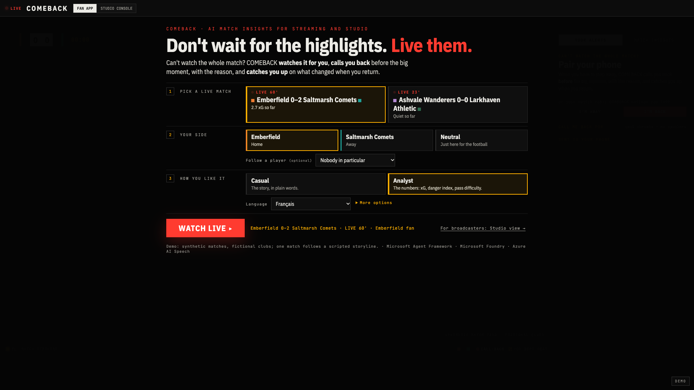
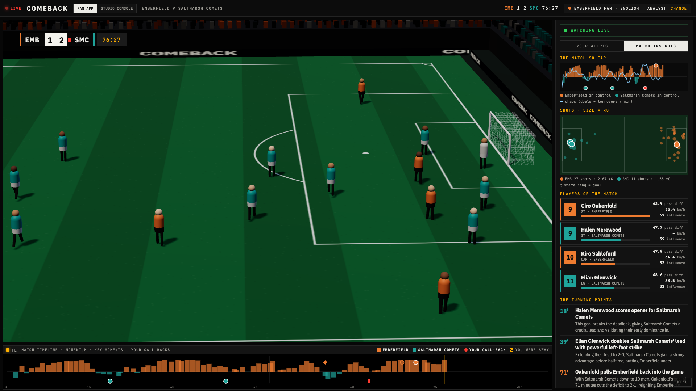
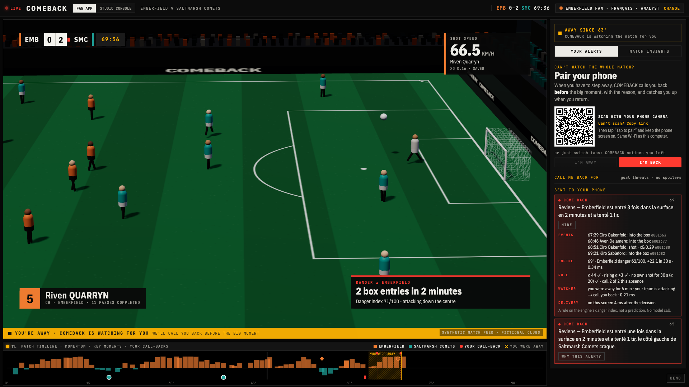
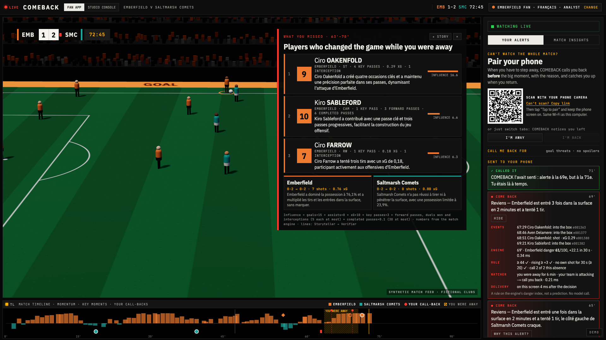
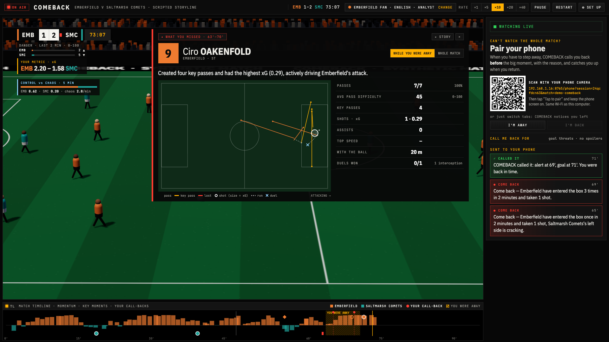
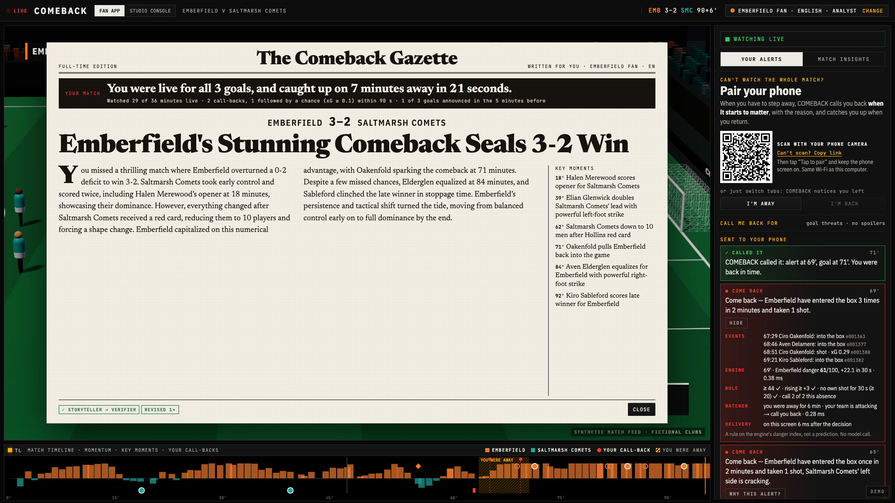
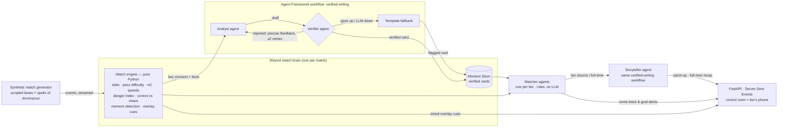
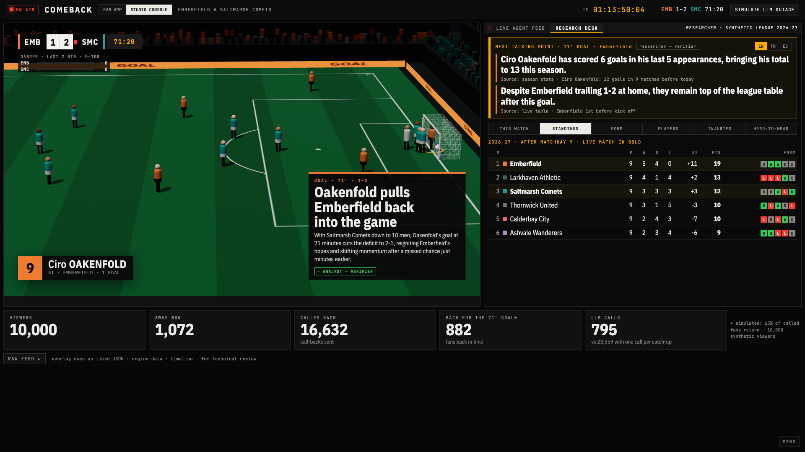
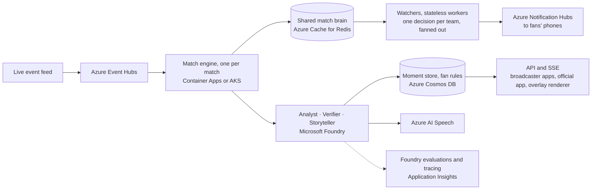

# COMEBACK

[](https://github.com/imaneoujja/comeback/actions/workflows/ci.yml)
[](https://comeback.lemonforest-f9ddbdf8.switzerlandnorth.azurecontainerapps.io)
[](https://codespaces.new/imaneoujja/comeback)


[](LICENSE)

**COMEBACK is an attention-aware match insights engine for streaming and studio. It watches the
match when you can't, calls you back when it starts to matter, and catches you up in seconds
when you return.**

Attention here means one thing: is the fan watching or away. It comes from the viewing app
itself, opt-in. No camera, no microphone.

**[Live demo](https://comeback.lemonforest-f9ddbdf8.switzerlandnorth.azurecontainerapps.io)** · **[Video (2 min)](https://youtu.be/h_aXo5JeWsk)** · **The fan journey in English:** [https://comeback.lemonforest-f9ddbdf8.switzerlandnorth.azurecontainerapps.io/?as=fan&side=home&lang=en&match=demo-comeback](https://comeback.lemonforest-f9ddbdf8.switzerlandnorth.azurecontainerapps.io/?as=fan&side=home&lang=en&match=demo-comeback)


### Don't wait for the highlights. Live them.

A fan who cannot watch the whole match today watches **nothing**, and sees the highlights
the next day. COMEBACK brings them back **live** for the moments that matter: more live
viewers, not fewer. It never pushes someone who can watch to leave. One product, three verbs:

**Watch for me → Call me back → Catch me up.**

COMEBACK reads every event of the match live, explains why moments matter, and
personalizes them for each fan (language, side, level, favourite player, one metric).
Step away, and it calls you back **when it starts to matter**, with the reason; come back,
and it replays what you missed, tells you what changed and shows **who changed the game**.
At full time, your receipt: *"You were live for 3 of 3 goals, and caught up on 7 minutes
away in 21 seconds."* (You left the match. COMEBACK didn't.)

- **54% of goals announced in advance**, 1.6× better than the same number of random
  alerts, on 50 unseen matches, with a **median warning of 60 s**. We announce big
  moments; we do not claim to predict goals.
- **Verified text**: every number and name is checked before a fan sees it. A single
  LLM agent doing everything delivers a factual problem in 12% of its texts; COMEBACK in 0,
  and Microsoft Foundry's evaluators score the 45 texts fans see 5.0/5 on groundedness.
- **One brain for every fan**: serving **200,000** simulated fans takes about
  **1,830** LLM calls instead of more than 630,000 (≈ $0.61 instead of ≈ $812).

> *The future of football isn't more screens. It's a match that fits your life.*

### Classic match alerts vs COMEBACK

| Classic match alerts | COMEBACK |
|---|---|
| After the moment | **Before it**, while it is still live |
| The same alert for everyone | **Personal to each fan**: side, language, level, their own rules, whether they are watching |
| Spoils the score | **Spoiler-free**: the score waits for your replay |
| Score-centric | **Story-centric**: what changed while you were away, and who changed it |
| No reason given | **Every alert explains why**, and *Why this alert?* shows the decision step by step |

### Try it in 60 seconds

1. Open the **[live demo](https://comeback.lemonforest-f9ddbdf8.switzerlandnorth.azurecontainerapps.io)** on a computer, pick a live match, your side and language, and press **WATCH LIVE**. To see the whole loop in about two minutes, open **DEMO** (bottom right, or press **D**) → **Autoplay**.
2. Or **[open it in GitHub Codespaces](https://codespaces.new/imaneoujja/comeback)**: it starts by itself on port 8000.
3. Or locally: `pip install -r requirements.txt && python -m comeback` → http://localhost:8000

No account, no key: it runs offline on recorded agent texts (see *Live vs recorded mode*).

> Built for *Inside the Game: Developer Hackathon* (Microsoft × Premier League), challenge
> "Synthetic Match Insights Engine". All data is **synthetic**; all clubs and players are
> **fictional**.

---

## What it does

| | What happens | In the demo match |
|---|---|---|
| **Watch for me** | You step away (switch tab, press I'M AWAY, or your phone). A Watcher agent keeps watching for you, under your own rules: goal threats, equaliser or winner only, any big moment, or **only if this match gets good** (a quiet spell that comes alive); night mode. It knows your side, favourite player, level and language. | An Emberfield fan (English, analyst) steps away at 63', 0–2 down. |
| **Call me back** | It calls you back **when it starts to matter**, and says why. Your phone takes over the screen, rings, and reads the reason aloud. | Calls at 65' and 69'. At 69': *"Come back — Emberfield have entered the box 3 times in 2 minutes and taken 1 shot."* |
| **Catch me up** | Spoiler-free: if a goal happened, your phone only said "something big happened"; the score waits for your replay. The TV rewinds: the moments you missed are replayed in 3D from behind the goal while a neural voice reads your "Previously on…" of what **changed**, sized to your absence. Then **What you missed**: the three players who changed the game, both teams then vs now (below). | 70': a spoken catch-up, then the 71' goal, seen live. The phone confirms: *"COMEBACK called it: alert at 69', goal at 71'. You were back in time."* |
| **Full-time** | Your receipt (live goals, minutes watched, what your alerts were worth) and your own front page: the match told from your side. | *"You were live for all 3 goals, and caught up on 7 minutes away in 21 seconds."* |


Two products on one engine, side by side in the top bar. The **Fan app** (the default)
opens on the matches **live now**: pick one, your side (or neutral, and optionally a player
to follow), how you like it (casual or analyst, your language), and **WATCH LIVE**. You join
the match where it is, with the story so far, then watch live: the TV (a 3D program feed
with broadcast graphics: player tags, pass difficulty, shot speed, speed and distance tags,
danger) and a panel to pair your phone. You do not choose when you step away: it happens,
and COMEBACK notices. The **Studio console** lists the same live matches with their
audience (viewers, fans away, call-backs sent) and opens a broadcaster's **control room** on
one of them: the program, a live feed of the agents' work (one card per moment, one per
call-back for the whole audience), the audience in five numbers, and **timed,
machine-readable overlay cues** a broadcast graphics renderer could consume.



## What the engine understands

A pure-Python engine reads every event once, as it happens (`comeback/engine/`), and every
number the fan or the studio sees comes from it, never from the LLM:

- **xG** for every shot, from distance and angle (`engine/xg.py`).
- **Pass difficulty** (0–100): distance, pressure, forward ratio, final third, long ball;
  pass accuracy, progressive passes and **key passes** (the receiver shoots within 15 s).
- **Shot speed and ball speed**, **sprint speed**, distance covered with the ball.
- **Danger index** (0–100, last two minutes) and its trend: box entries, final-third passes,
  shots weighted by xG, corners, balls won high (`engine/danger.py`).
- **Control vs chaos**: rolling possession × pass accuracy against duels and turnovers per
  minute; **momentum swings** when control changes hands.
- **Rhythm**: minute-by-minute momentum, and "this match got good" when a quiet spell
  comes alive.
- **Influence**: goals, assists, xG, key passes, forward passes, duels won and interceptions,
  with volume capped (`fans/missed.py`).
- **Milestones**: fastest shot and top speed of the match, 50 completed passes; storylines
  (redemption, the substitute's impact, the comeback, numerical advantage).

The fan app shows it in **Match insights** (open by default for analysts, one click for
casual fans): the match curve with its key moments, the shot map sized by xG, the players
of the match (a click opens their sheet), and the three turning points with their verified
"why it matters".



## Call me back: does it announce anything?

**COMEBACK announces big moments; it does not predict goals.** We measure how often
its call-backs come true, with a fixed protocol (`scripts/evaluate_alerts.py`):

- **Matches:** unscripted synthetic matches only (random fixtures, no story beats). The
  scripted demo match is never used for these numbers; the script refuses it.
- **Tuning vs test:** the threshold was tuned on seeds 1001–1050 (to announce at least
  half of the goals) and is reported on **50 other, held-out matches** (seeds 2001–2050).
- **Precision:** an alert "comes true" if the same team has a shot with xG ≥ 0.1 within
  **90 s**. **Recall:** a goal is "announced" if an alert for the scoring team came in the
  previous **5 minutes** (the anticipation window). Lead time = goal time − last alert.
- **Chance baseline:** the **same number** of alerts placed at random instants (same
  teams), averaged over 20 random draws, scored with the same definitions.

| Held-out unscripted matches (129 goals) | COMEBACK | Same number of random alerts |
|---|---|---|
| Recall: goals announced within 5 min | **54%** (70/129) | 34% (**1.6×**) |
| Precision: alerts followed by a chance (xG ≥ 0.1) within 90 s | **21%** | 8% (**2.8×**) |
| False alerts per match (both teams) | 11.6 | 13.5 |
| Alerts per team per match | 7.3 | same |
| **Call-backs one fan actually receives per match** (simulated absences, max 2 per absence) | **1.9** | |
| Median warning before an announced goal | **60 s** | |
| Median time from an alert to the chance that follows | 16 s | |
| Decision latency (event → alert decision, compute) | p50 0.02 ms · p95 0.04 ms | |

Stricter or looser, at a glance (same held-out matches):


| Threshold | Recall | Precision | Alerts / team / match |
|---|---|---|---|
| 36 | 70% | 19% | 10.8 |
| **44 (default)** | **54%** | **21%** | **7.3** |
| 55 (night mode) | 32% | 23% | 3.2 |
| 65 | 9% | 30% | 0.8 |

**"Only call me if this match gets good"** keeps the same rule but fires only after at least
8 quiet minutes (both teams' danger below 35): in a separate run on 40 other unseen matches
(not the 50-match evaluation above), about **1.9 calls per match** for both teams together
(against about 15 for the default rule), and at least one in 34 of them.

Honest reading: most goals in our simulator come from short attacks, so many goals
are not preceded by sustained pressure, and most alerts are not followed by a goal.
That is why a fan receives at most two calls per absence, sets their own rules
(goal threats, equaliser or winner only, any big moment; night mode raises the bar
to 55 and calls once), and why every call states its reason instead of promising a
goal. Validated on synthetic data; real-data validation is future work. In the
scripted demo every goal is preceded by a call about the scoring team: that is a
design check of the story (a test), not a performance claim.

### The danger index, in the open

Every call-back cites the facts that triggered it (its card in the studio's LIVE AGENT FEED
shows why now, the rule and who was called).

| Ingredient (for the attacking team) | Weight |
|---|---|
| Pass or carry into the box | 8 |
| Shot | 10 + 40 × xG |
| Corner | 6 |
| Ball won in the opponent's half | 5 |
| Completed pass into the final third | 2 |
| Successful pressure | 2 |
| Completed pass in the opponent's half | 0.6 |

Each contribution decays exponentially (time constant 60 s; forgotten after 6 min), the
sum is squashed into 0–100 with `100 · tanh(sum / 55)` (`comeback/engine/danger.py`).
The alert rule (`comeback/engine/alerts.py`): danger ≥ 44 (night mode 55), rising by at
least 3 points over 30 s, not within 20 s of the team's own shot (that chance is over),
3-minute cooldown, at most 2 calls per absence (night mode 1).

### Why this alert?

Every call-back on the fan's screen unfolds into its decision, step by step, with real times:
the events that raised the danger (match clock and event ids), the engine's danger index and
its trend (with the milliseconds the engine took), each condition of the rule, the Watcher's
decision for this fan (how long they had been away, which side they are on, and its own
milliseconds), and how long the alert took to reach the screen. The 69' call in the demo:
three box entries and a shot between 67:29 and 69:21 → danger 61/100, +22 in 30 s (engine
0.38 ms) → threshold, trend, no own shot for 30 s, call 2 of 2 → the Watcher calls back a fan
away for 6 minutes (0.28 ms) → on screen 6 ms later. A rule, not a prediction; no model call.



### Latency and load

| Measured | Value |
|---|---|
| Danger → alert decision (engine update + rule, compute) | p50 0.02 ms · p95 0.04 ms |
| Alert decision → the fan's screen (server push over SSE, measured in the browser, localhost) | 10–13 ms |
| Alert → the chance it announced (median) / → the goal (median, when announced) | 16 s / 60 s |
| 10 simultaneous viewers, ×40 replay (`scripts/load_test.py`, local machine) | 0 errors · 13 events/s per viewer · API p50 5 ms, p95 9 ms |
| 10 simultaneous viewers on the **public demo** (Azure Container Apps, 0.5 vCPU, measured from Paris) | 0 errors · full event rate · API p50 0.53 s, p95 0.64 s, the same as with 1 viewer (network distance, not load) |

The engine, the Watchers and the Verifier run live for every viewer; the 10,000-fan
audience is simulated once per match and shared, so a new viewer costs one replay loop.

### Reproduce the numbers

```bash
python scripts/evaluate_alerts.py                     # held-out table above (seeds 2001-2050)
python scripts/evaluate_alerts.py --first-seed 1001   # the tuning matches
python scripts/evaluate_alerts.py --curve             # threshold sweep + docs/alert_curve.svg
python scripts/compare_single_agent.py                # multi-agent vs one agent (offline, cached replies)
python scripts/load_test.py --viewers 10 --seconds 30 # needs a running server
python scripts/evaluate_texts.py                      # Foundry evaluations (needs a Foundry key)
curl localhost:8000/api/scale/demo-comeback           # LLM calls by audience size
```

## Catch me up

When you come back (or join late), the TV replays what you missed while a neural voice reads
what changed, sized to your absence. Then two screens that only exist for *your* window.

### What you missed

After the replay and the voice-over, the TV shows the **players who changed the game while
you were away**, ranked by a transparent influence score (goals ×15, assists ×8, xG ×10,
key passes ×3, plus forward passes, duels won and interceptions, capped so that a long
window ranks the players who decided it, not the ones who touched the ball most). Each
player opens a sheet: their actions on a 2D pitch (passes, key passes, shots sized by xG,
runs, duels) and their numbers, *While you were away* or *Whole match*. Each team opens a
sheet compared with the match as you left it. Every number comes from the match engine
(the window's events replayed on their own, `comeback/fans/missed.py`); the one-line "why
it matters" is written by the Storyteller and checked by the Verifier for the precomputed
windows, and is a factual template for any other window: no model call per fan.





### Your full-time receipt

*"You were live for N of M goals, and caught up on the rest in X seconds."* Below it: the
minutes you watched live, your call-backs and how many came true, with the same
definitions as the alert evaluation below (a chance with xG ≥ 0.1 within 90 s; a goal
announced by an alert in the 5 minutes before). A stretch you skipped counts as neither
live nor caught up; the seconds are measured by the screen (replays plus voice-overs).



## How it works



### Agents, distinct roles, one shared state

| Agent | Input | Output | LLM? |
|---|---|---|---|
| **Analyst** | Compact computed facts of one key moment (never the raw event log), plus the match situation | Headline + "why it matters" (English, neutral), cited event ids | Yes |
| **Verifier** | A draft + the facts + the roster | Pass, or precise feedback for a retry | Rules (deterministic) |
| **Watcher** (one per fan) | The live danger index, the fan's presence and profile | "Come back" decision + reason, goal notifications, a "called it" receipt when a goal follows its call-back | No: instant and free per fan |
| **Storyteller** | The verified cards of the away window, a "what changed" delta, the fan profile | Catch-up or full-time recap in the fan's language, level and point of view | Yes |
| **Researcher** | A verified moment card + one or two context facts from the synthetic league's records (scorer's season, the table if the score holds, form, injuries, suspensions, head-to-head), each with its source | A commentator's talking points for the studio, in English, French or Spanish, checked by the Verifier against those records | Yes (precomputed for the demo; factual template otherwise) |

**Scale, in one line.** One LLM pass per moment, shared by every fan, plus one deterministic
Watcher per fan: **200,000 fans ≈ 1,830 LLM calls** for the whole demo match, against 633,938
with one call per catch-up (**SIMULATED** audience; see *One match brain for every fan*).

- **Orchestration.** Analyst → Verifier → retry → fallback is a **Microsoft Agent
  Framework workflow** (`comeback/agents/workflow.py`) with typed executors and
  conditional edges. The *same* workflow serves the Storyteller and the Researcher. Every step is
  traced live in the studio's LIVE AGENT FEED, one card per moment.
- **Shared state and handoffs.** The engine and the Moment Store are written once
  and read by every Watcher and by the Storyteller. A moment gets a template card
  instantly, so nobody waits for the LLM; it is upgraded when the verified card lands.
- **Recovery from failure.** Rate limit (429), timeout, network error, budget
  exhausted, invalid JSON, or three rejected drafts: each ends with a
  deterministic, fact-based template flagged `source: "template"`. Tests force
  every path.
- **Failure drill, live.** In the studio, **SIMULATE LLM OUTAGE** cuts the model
  for your session only (`POST /api/session/{id}/outage`): every agent call fails
  as a real outage would, cards and catch-ups keep arriving as verified templates
  (amber badge), the stream never stops, and **RESTORE** brings the writers back.
- **Fact-checks on screen.** When the Verifier rejects a draft, the moment's card in the
  LIVE AGENT FEED shows it: the wrong words struck through, the Verifier's reason, then the
  version that went on air. In the demo, at 59' the Researcher wrote "With this *2-0 lead* at
  home, Emberfield…" while Emberfield were 0-2 down; the Verifier rejected it ("Wrong side"), and
  the corrected point, "Despite trailing 0-2 at home…", is the one the commentator gets. At 81' the
  Analyst gave the ten men "their numerical advantage"; that draft never aired either.


## One match brain for every fan

The studio simulates an audience of 10,000 fans with random absences and late joins,
all served by the same engine and agents. Alert decisions are computed **once per
team**; a catch-up needs a new LLM story only when its (moments, language, level,
club, length) combination has never been written.

LLM calls needed to serve the whole demo match, by audience size (`/api/scale`):

| Fans | COMEBACK | One LLM call per catch-up |
|---|---|---|
| 1,000 | 659 | 3,077 |
| 10,000 | 1,191 | 31,591 |
| 50,000 | 1,515 | 158,631 |
| 200,000 | **1,830** | **633,938** |

The right-hand column is one call per catch-up (633,921 at 200,000 fans) plus the match's 17
key-moment cards (633,938); the single agent below writes its cards inside each catch-up, so it
needs 633,921.

These are cost figures on the scripted demo match. They say nothing about how
accurate the alerts are: that is measured separately, below. The audience is
simulated once per match and shared by every viewer of that match (not once per
visitor). "Fans back in time for the goal" (882 for the 71' goal) rests on a
**simulation assumption**: 65% of called fans return within two minutes. A real
figure needs an A/B test in production.

## The Verifier earns its place

These are real errors from our recordings with `gpt-4.1-mini` (plus one our
tests caught). Each one became a rule:

| The model wrote | Why it was wrong | Rule now enforced |
|---|---|---|
| "Emberfield equalise *despite being a man down*" | Saltmarsh Comets had the red card | A "ten men" claim must name the short-handed team |
| "*the fastest shot of the season*" | The facts only cover this match | No season, league, career or all-time claims |
| "*The striker almost extended the lead* for Emberfield" | Emberfield were trailing 1-2 (the bare score "1-2" was misread) | Every score handed to the agents is labelled with team names |
| "Emberfield *grabbed a well-earned draw*" (at 86') | The match was not over | No final result (win, draw, defeat) before full-time, in all three languages |
| "Emberfield won, *overcoming a numerical advantage for Saltmarsh Comets*" | Saltmarsh Comets had 10 players | Numerical advantage or disadvantage claims must attach to the right team, including "for X", "against ten-man X" and "overcoming…" |
| "The striker scores his *9th*" (test case) | Invented: the 9 came from the player id `EMB-9` | Every number must exist in the facts; ids are not statistics |
| "Larkhaven drew 2-2 *despite fewer chances*" | Larkhaven had 21 shots to 7. Our rules missed it; **Foundry's groundedness judge caught it** (2/5) | Comparative claims (fewer/more chances, shots, possession) must agree with the per-team stats |
| Researcher, 59': "*With this 2-0 lead at home*, Emberfield…" | Emberfield were trailing 0-2: every number was right, the side was wrong | A lead or a deficit in a talking point must belong to the right club |
| Researcher, 68': "Oakenfold, 12 goles, *superando su xG* de 14.07" | 12 goals is below 14.07 xG | Over/under-xG, "last season" vs this season, "first meeting" and "all of his goals" claims must agree with the league's records |
| Full-time recaps (10 of the 20 recorded for the demo before the rule) | They told a 3-2 win without ever saying 0-2: the comeback disappeared | A full-time recap must give the final score and the biggest gap of the match |

The Verifier also rejects players who are not part of the moment, clubs outside
the match, insulting or mocking words about players, betting talk, and over-long
texts. And it was tuned against its own false positives: "Emberfield, playing against
ten men" is correct and now passes (the ten men are the opponents of the team named
before).

### One agent, or a team of agents?

The principle: **LLMs where language is needed, deterministic code where truth is needed.**
To check that the split pays off, `scripts/compare_single_agent.py` gives ONE LLM agent the
same engine facts and the same instructions about names and numbers, and asks it to write
every moment card and a fan's catch-up in one call (no verification), for 3 fans on the demo
match and 2 unscripted matches. It only sees what had happened when the fan came back. Every
text is then checked with the Verifier's rules.

| | One LLM agent does everything | COMEBACK (Analyst → Verifier → Storyteller, shared brain) |
|---|---|---|
| Texts with a factual problem delivered to fans | **7 / 57 (12%)** | **0 / 57** (2 template fallbacks) |
| Key moments left without a card | 47 of 95 | 0: a template card at once, the verified text when ready |
| What went wrong / what was caught | player or club not in the facts 5, invented or wrong number 4, result announced before full time 2 | caught before air: invented or wrong number 5, numerical advantage on the wrong team 5, player not in the facts 3, early result 1 |
| LLM calls for 200,000 fans (demo match) | 633,921 (one per catch-up) | **1,830** (cards once, stories shared) |
| Cost for 200,000 fans (gpt-4.1-mini list price) | ≈ $812 | **≈ $0.61** |
| Latency | ≈ 3.9 s per fan (first recording), only after the absence | template card instantly; verified card ≈ 1.0 s (median call) |

Replies are cached in `data/experiments/compare_cache.jsonl`, so the table replays offline. Re-recorded
on 25 Oct with the current code (69 small calls for COMEBACK, 9 large ones for the single agent).
The 2 template fallbacks are texts whose three drafts the Verifier rejected.
The single agent is not a strawman: same model, same facts, same rules in its
instructions; it simply has nobody to check it and no shared memory across fans.

### Foundry evaluations, before and after the Verifier

*Measured on 25 Oct, on the texts the demo shows today.* `python scripts/evaluate_texts.py` replays both playable matches, recovers the exact facts
behind every draft, and scores it with Microsoft Foundry's AI-assisted evaluators
(`azure-ai-evaluation`, judge: our `gpt-4.1-mini` deployment, 1–5). *Before* = the first
draft of every text (what a pipeline without the Verifier would show); *after* = the texts
fans actually see.

| Texts (demo + unscripted match) | n | Groundedness | Coherence | Fluency | Groundedness < 4 |
|---|---|---|---|---|---|
| Before the Verifier: first drafts | 45 | 5.00 | 4.31 | 3.96 | 0 |
| … of which the Verifier sent back | 7 | 5.00 | 4.57 | 4.00 | 0 |
| **After the Verifier: texts shown to fans** | **45** | **5.00** | 4.27 | 3.93 | **0** |
| Control: 3 cards deliberately corrupted (teams swapped, invented stat) | 3 | **2.00** | 3.67 | 3.33 | 3 |

What we learned: the LLM judge and the rule-based Verifier catch **different** errors, and the
judge is not stable on subtle ones. On 25 Oct it scored all 7 drafts the Verifier sent back 5/5,
among them a numerical advantage given to the ten men and "despite fewer chances" with 21 shots
to 7. On 21 Oct the same judge had flagged that last claim (2/5) when our rules missed it; we
turned it into a rule, and the rule now catches it every time. The Verifier can
be too strict as well: it once rejected every Comets fan's full-time story for "leaving
**you** with 10 men" (true for that fan) and Spanish texts for *el empate* (the equaliser,
not a final draw); both rules now read the fan's point of view and the language. The
control row shows the judge is not lenient on gross errors. Details per text:
[`docs/evaluation.json`](docs/evaluation.json).

## The Studio: a producer's console

The studio is a producer's console: the match on the left, the story of the agents on the
right, the audience below.


Every call-back has its own card: why now (danger and its trend, box entries and shots in
the last two minutes, where), the rule checked (sustained pressure, not a prediction), who
was called (the away fans of both sides, counted per side), whether it came true, and a
**PREVIEW** of the same call as three different fans receive it.


### Research Desk: a commentator's notes

The studio's **RESEARCH DESK** (next to the LIVE AGENT FEED) gives the commentator context the
match alone cannot: a synthetic league built around the live matches (`scripts/build_league.py`,
`data/league/league.json`). The current season's first nine matchdays and last season are
simulated by the same simulator and read by the same engine; matchday 10 holds the two live
matches. Injured players started before their injury and are not on today's team sheet;
nobody on a live team sheet is suspended (both tested).

On top, one card: the **next talking point** the Researcher recommends, with its source in the
records ("13th goal of the season for Ciro Oakenfold, 6 in the last 5 matches" · *season stats:
12 goals in 9 matches before today*), in English, French or Spanish. Below: This match (the
engine's pictures), Standings, Form, Players (season leaders and records), Injuries,
Head-to-head. The Researcher is a fifth agent with its own role: it only adds context, every
number and name is verified against the league's records, and a factual template takes over
when there is no verified text. On the demo match, 42 of 51 talking-point sets (moment ×
language) are verified model text; the other 9 fell back to the template after three rejected
drafts. A talking point names players in full ("Ciro Oakenfold", never "Oakenfold"), and no
injured player shares a surname with a player of the live matches (tested).



## Why not just stream it on your phone?

Because a stream, or a commentary turned up loud, asks for 90 minutes of attention, and
COMEBACK is built for the moments when you have none to give: on the touchline at your
kid's match (our main case), on a work call, putting the kids to bed, or asleep through a
4 a.m. kick-off in another time zone (night mode: "wake me only if…"). Your phone is in
your pocket, face down. It is not COMEBACK's competitor; it is its channel: one buzz, one
sentence with the reason, at the right time, at most twice per absence, opt-in and under
your rules. And when you are back, the stream does not tell you what changed. COMEBACK
does, in your language and from your side.

**For broadcasters and the official app (B2B2C):** COMEBACK is a layer they integrate, not
one more app. It does not pull viewers away from the live feed; it brings back fans who
had already left, when it starts to matter, instead of sending a spoiler after it. In the
simulation, 882 of 10,000 fans were back in time for the 71' goal (assumption: 65% of
called fans return; a real figure needs an A/B test in production).

## Try it (zero configuration, no API key)

**Online:** open the [live demo](https://comeback.lemonforest-f9ddbdf8.switzerlandnorth.azurecontainerapps.io) in a desktop browser. As a fan, scan the
**Pair your phone** QR code next to the match: your phone becomes your device, from anywhere.
The app scales to zero when nobody uses it, so the first request wakes it up.

**GitHub Codespaces:** click the Codespaces badge at the top. The server starts by itself; open
the forwarded port **8000**.

**Locally** (Python ≥ 3.10):

```bash
git clone https://github.com/imaneoujja/comeback.git && cd comeback
python -m venv .venv && source .venv/bin/activate   # Windows: .venv\Scripts\activate
pip install -r requirements.txt
python -m comeback                                   # → http://localhost:8000
```

It runs **offline by default**, and what you see is live: on every visit the match
engine, the danger index, the Watchers, the Verifier and the simulated audience run
for real. Only the agents' texts for the two playable matches are cached
(`data/llm_cache.jsonl`, written once by Foundry), so you see real model output
without any key; a window we did not precompute gets a verified template instead.
Two synthetic matches are "live": a scripted storyline (the comeback, joined at 60') and
an unscripted one (joined at 23', quiet so far), replayed with the same engine, Watchers
and Verifier.

### What to try

1. **Fan app** (the default). Pick a live match, your side, how you like it, **WATCH LIVE**.
   You join where the match is: the TV replays the goals you missed while a neural voice
   tells the story so far, then **What you missed** shows the players who made it. Then you
   watch live. When you have to step away, switch browser tab or press **I'M AWAY**: COMEBACK
   calls you back when it starts to matter (pair your phone with the QR code to get the call
   on it), and catches you up when you return. On the quiet match, try **Only call me if it
   gets good**. **CHANGE** (top bar) switches side, player, language or style without
   restarting the match.
2. **Demo controls** (the **DEMO** button bottom right, or the **D** key): rate, jump to a
   minute, restart from kick-off, and **Autoplay**, which plays the whole scenario on the
   scripted match: you leave at 63', the call-backs at 65' and 69', back at 70' (replay,
   voice-over, What you missed), the 71' goal live, then full time and your receipt.
3. **Studio console** (top bar): open the producer's console on a live match: the program
   on the left, the **LIVE AGENT FEED** on the right (one card per moment: detected → Analyst
   → Verifier ✓ or ✗ with the draft struck through → on air; one card per call-back: why now,
   how many fans, **PREVIEW** of the same call for three fans), the audience in five numbers
   below, and **SIMULATE LLM OUTAGE** to watch the show go on without the model. **RAW FEED**
   unfolds the timed overlay cues (JSON), the engine data and the timeline.

## How we measured

Every number in this README, how it was obtained, and whether it is **MEASURED** (computed on
real runs of the code) or **SIMULATED** (it depends on a simulated audience or an assumption).
All matches are synthetic.

| Number | Method | Sample | Definition | Type |
|---|---|---|---|---|
| **54%** of goals announced, **1.6×** random | `scripts/evaluate_alerts.py` | 50 held-out unscripted matches (seeds 2001–2050), 129 goals; threshold tuned on seeds 1001–1050 | An alert for the scoring team in the 5 minutes before the goal; random = same number of alerts at random instants, 20 draws | MEASURED |
| **21%** precision, **2.8×** random | same | same | An alert followed by a chance (xG ≥ 0.1) for that team within 90 s | MEASURED |
| **60 s** median warning | same | the 70 announced goals | Goal time − last alert before it | MEASURED |
| **1.9** call-backs per fan per match | same | simulated absences on the same matches | At most 2 calls per absence | SIMULATED (absences) |
| **0 / 57** vs **7 / 57** texts with a factual problem | `scripts/compare_single_agent.py` | demo + 2 unscripted matches, 3 fans each: 48 key moments + 9 catch-ups | The Verifier's rules applied to every text a fan would see | MEASURED |
| **5.0 / 5** groundedness | `scripts/evaluate_texts.py`, Foundry evaluators (judge `gpt-4.1-mini`) | 45 texts shown to fans, both playable matches (25 Oct) | Foundry's groundedness score against the facts each text was given | MEASURED |
| **190 of 192** catch-ups and recaps, **42 of 51** talking-point sets are verified model text | `scripts/precompute.py` | 24 fan set-ups × 2 matches; the demo's key moments × 3 languages | Passed the Verifier (the rest: verified templates) | MEASURED |
| **1,830** LLM calls for **200,000** fans (vs 633,938), **≈ $0.61** (vs ≈ $812) | `GET /api/scale/demo-comeback` | demo match, audiences of 1k to 200k fans with random absences and late joins | Cards written once; a story per distinct (moments, language, level, side, length); list price of `gpt-4.1-mini` | SIMULATED (audience) |
| **882** fans back in time for the 71' goal | studio audience | 10,000 simulated fans | **Assumption: 65% of called fans return within 2 minutes** | SIMULATED |
| Decision **p50 0.02 ms**, delivery **7–13 ms** | `evaluate_alerts.py`; *Why this alert?* in the browser | every alert decision; local machine | Engine update + rule; server decision → screen over SSE | MEASURED |
| **0 errors** for 10 viewers | `scripts/load_test.py` | 10 simultaneous sessions, local and on the public demo | HTTP errors, API latency | MEASURED |
| Realism: 878 passes, 79%, 26.1 shots, 3.06 xG, 2.85 goals | `tests/test_synth.py` | 20 unscripted matches | Match averages, checked against ranges by a test | MEASURED |

## Live vs recorded mode

| `LLM_MODE` | What the agents' texts are | Needs |
|---|---|---|
| `offline` (default) | **RECORDED**: model replies written once by Microsoft Foundry, verified, committed in `data/llm_cache.jsonl`, replayed; anything never recorded becomes a verified **TEMPLATE** | nothing |
| `live` | **LIVE LLM**: written by Foundry now, then verified; replies are cached for the next viewer | a Foundry deployment |
| `record` | live, and writes the cache (how the demo was precomputed) | a Foundry deployment |

**Why the demo uses the recorded texts.** Judges need no key, no account and no cost, and every
run shows the same verified texts. Everything else runs live on every visit: the engine, the
danger index, the Watchers, the Verifier and the 10,000-fan audience. The studio's feed marks
every text **LIVE LLM**, **RECORDED** or **TEMPLATE**, so you always know which one you see.
The Researcher's talking points and the *What you missed* lines are served from the recording
even in `live` mode (no model call per viewer), unless you record.

**Going live as a judge** (your own Foundry deployment of `gpt-4.1-mini`):

```bash
cp .env.example .env    # set FOUNDRY_ENDPOINT, FOUNDRY_API_KEY, FOUNDRY_MODEL
LLM_MODE=live python -m comeback                 # any absence gets a freshly written story
LLM_MODE=record python scripts/precompute.py     # re-record: 24 fan set-ups × 2 matches, what-you-missed lines, talking points
```

A daily call budget (`LLM_DAILY_LIMIT`, 300 by default) and a rate limiter (10 calls a minute)
protect the credit.

## Production path

The demo runs as one container. At broadcast scale:

- **Presence from the video player.** The signals already exist in the viewing app: playback
  paused, the app sent to the background or closed, the stream stopped on the TV. Opt-in, no
  camera, no microphone. In this demo: switching browser tab (Page Visibility API), *I'm away /
  I'm back* on the screen or on the paired phone, and joining a match in progress.
- **Fan state in shared storage.** Presence, alert rules, alerts sent and away windows live in a
  shared store (Azure Cache for Redis for the hot state, Azure Cosmos DB for rules and history),
  so any instance can serve any fan and an instance can restart without losing anyone.
- **Horizontal scale.** One engine per match; Watcher decisions are made once per team and fanned
  out by stateless workers; texts are shared by (moments, language, level, side, length); real
  push (APNs, FCM, Web Push through Azure Notification Hubs) replaces the demo's server-sent
  events to a paired phone.



**Business model (B2B2C).** COMEBACK is a layer that broadcasters, streaming platforms and
the official app integrate, not one more app for fans: an SDK and API for presence-aware
call-backs, catch-ups and overlay cues, priced per match or per active viewer. Its value
for the integrator is live minutes and ad inventory: fans who had left come back when it
starts to matter.

**Cost per match at 200,000 fans** (demo match, list prices): about **1,830 LLM calls ≈ $0.61**
(cards written once, stories shared by fans with the same moments, language, level, side
and length), plus ≈ $16 of neural voice if every distinct story is spoken: about
**$0.0001 per fan**. One LLM call per fan would cost ≈ $812 for the text alone.

## Responsible AI

- **No betting, no odds, no prediction market.** COMEBACK announces pressure and big
  moments with the reason; it never states a probability that a goal will happen, and the
  Verifier rejects betting talk (odds, bets, wagers, in three languages).
- **Respect for people.** Players are real people in real products: the Verifier rejects
  insulting or mocking words about a player or a club, in English, French and Spanish
  (`check_respect` in `comeback/agents/verifier.py`).
- **Facts before fluency.** Every number and every name must exist in the engine's facts;
  numerical-advantage claims must name the right team; no final result before full time;
  nothing outside the match (season, career). What fails is rewritten or replaced by a
  template built from verified facts, and the text says which (`AI-generated · fact-checked`).
- **The fan is in control.** Opt-in alerts, the fan's own rules, at most two calls per
  absence, spoiler-free by default, night mode. No camera, no microphone: presence comes
  from the fan's own signals (see Presence signals).
- **Honest numbers.** Alert metrics on unscripted matches only; the simulation assumption
  behind "fans back in time" is written where the number appears.

## Judging criteria → evidence in the code

| Criterion | Evidence |
|---|---|
| Technological implementation | Pure-Python streaming engine ([`comeback/engine/`](comeback/engine/)), synthetic generator with realism tests ([`comeback/synth/`](comeback/synth/), [`tests/test_synth.py`](tests/test_synth.py)), 94 tests and ruff in CI ([`.github/workflows/ci.yml`](.github/workflows/ci.yml)), container on Azure Container Apps ([`Dockerfile`](Dockerfile)) |
| Agentic design | Agent Framework workflow Writer → Verifier → retry → fallback ([`comeback/agents/workflow.py`](comeback/agents/workflow.py)); one Watcher per fan with a visible decision chain ([`comeback/agents/watcher.py`](comeback/agents/watcher.py), *Why this alert?* in [`web/js/panels.js`](web/js/panels.js), call-back cards in [`web/js/studio.js`](web/js/studio.js)); shared match brain ([`comeback/agents/brain.py`](comeback/agents/brain.py)); failure drill ([`comeback/agents/llm.py`](comeback/agents/llm.py) `SwitchableGateway`); MCP server ([`comeback/mcp_server.py`](comeback/mcp_server.py)) |
| Multi-agent vs one agent | [`scripts/compare_single_agent.py`](scripts/compare_single_agent.py) → [`docs/single_agent_comparison.json`](docs/single_agent_comparison.json) |
| Real-world impact | Alert protocol and numbers ([`scripts/evaluate_alerts.py`](scripts/evaluate_alerts.py) → [`docs/alerts_eval.json`](docs/alerts_eval.json)), cost at scale ([`comeback/fans/crowd.py`](comeback/fans/crowd.py), `/api/scale`), load test ([`scripts/load_test.py`](scripts/load_test.py)), overlay cues for renderers (`/api/overlays`, `/docs`) |
| UX and presentation | Two products in one top bar: a Fan app that opens on the matches live now (side, player to follow, style, language: [`web/js/setup.js`](web/js/setup.js)) and a Studio console; demo controls kept apart in a drawer; a TV-only fan view with a phone pairing panel; spoiler-free return; the fan's own alert rules ([`comeback/fans/session.py`](comeback/fans/session.py)); readable team shapes on the pitch, checked by tests ([`web/js/formation.js`](web/js/formation.js)) |
| Category fit (multi-agent) | Distinct roles, shared state, handoffs, recovery, and an outcome one agent does not reach: the table above |

## Challenge requirement → where in COMEBACK

| Requirement | Where |
|---|---|
| (i-a) **Ingest** events as they happen | `comeback/synth` generates the events; `api/replay.py` streams them; `engine/match.py` processes them one at a time, with no look-ahead |
| (i-b) **Interpret** into stats, patterns, context | `engine/state.py`: possession (overall and rolling), pass accuracy and difficulty, xG, speeds, distance with the ball, control vs chaos; `engine/danger.py`, `engine/moments.py` |
| (i-c) **Explain** why a moment matters | Analyst's "why it matters"; storylines (redemption, the substitute's impact, comeback, numerical advantage); delta-based catch-ups |
| (i-d) **Render** on screen, machine-readable | 3D program feed with broadcast graphics; `GET /api/overlays/{match}`: timed JSON cues per layer and audience, streamed live in the studio's **RAW FEED**; OpenAPI at `/docs` |
| (i-e) **Personalize** | What the fan saw or missed (away, back, late join, spoiler-free return, **What you missed** for their own absence window, their full-time receipt); the fan's own alert rules (goal threats, equaliser or winner, any big moment, only if this match gets good, night mode); club point of view; player mode (the followed player tagged all match); casual vs analyst live (words vs numbers on the danger and control graphics, different overlays and stories); language; one focus metric on screen. In the studio, each call-back card previews the same call for three audience segments |
| (ii) Player identification | Lower-third name tags; the followed player is labelled in 3D all match; player sheets in What you missed |
| (ii) Speed and distance on thresholds | Speed tag at ≥ 32 km/h sprints; distance tag every 100 m a player covers with the ball |
| (ii) Pass quality | Distance, accuracy and a 0–100 difficulty rating, with ball speed; key passes (the receiver shoots within 15 s) |
| (ii) Ball and shot speed | Pass ball speed; shot speed tag on every shot |
| (ii) Auto-eventing from video | **Not implemented.** COMEBACK works on event streams (synthetic here) |
| (iii) Narratives, player context, milestones, recaps | Moment cards; milestones (fastest shot, top speed, 50 completed passes); catch-ups; the players who changed the game in the fan's absence, with a verified line each; per-fan full-time recap and receipt |
| (iv) Control vs chaos, pressure, rhythm | Live "control vs chaos" graphic (rolling possession × accuracy; duels + turnovers per minute); danger index and its trend; momentum swings; momentum timeline; every call-back's decision chain (events → state → insight → decision); "this match got good" (a quiet rhythm turning into danger); team sheets: control and danger as you left vs as you found them |
| (v) Synthetic data innovation | Possession simulator with spells of dominance, transparent scripted beats, realism tests, a 10,000-fan audience simulation, and a synthetic league built around the live matches: this season (9 matchdays simulated and read by the same engine) and last season, injuries and suspensions, all coherent with the live team sheets (tested) |
| (vi) Multi-language storytelling | Catch-ups, alerts and recaps in English, French and Spanish, neural voice per language, and a checked **Show English** translation under every non-English catch-up |

## Microsoft technologies

| Technology | Where |
|---|---|
| **Microsoft Agent Framework** (Python) | The LLM agents (Analyst, Storyteller, Researcher) are `agent_framework.Agent`s. The verified-writing workflow is an Agent Framework `WorkflowBuilder` graph: writer, Verifier and fallback executors, conditional edges, a retry loop, and a live trace of every step (`comeback/agents/workflow.py`, `llm.py`). |
| **Microsoft Foundry** | LLM inference for the Analyst, the Storyteller, the Researcher and the Translator ("Show English"): Azure OpenAI `gpt-4.1-mini`, Global Standard deployment, through Foundry's OpenAI-compatible v1 endpoint. A 30k TPM cap and a daily call budget protect the credit. |
| **Microsoft Foundry evaluations** (`azure-ai-evaluation`) | Groundedness, coherence and fluency of the agents' texts, before and after the Verifier, with a corrupted control set (`scripts/evaluate_texts.py`, results in `docs/evaluation.json`). |
| **Azure AI Speech** (through the same Foundry resource) | Neural voices read each fan's catch-up and full-time recap in their language (`en-GB-RyanNeural`, `fr-FR-HenriNeural`, `es-ES-AlvaroNeural`) while the program feed replays the missed moments (`comeback/agents/speech.py`). The demo's audio is committed, so offline mode still speaks. |
| **Azure Container Apps** | The public demo: the CI image from `ghcr.io`, Consumption plan, 0.5 vCPU, 1 GiB, offline mode; one replica kept warm during judging (27 Oct–10 Nov), scale to zero otherwise. |
| **GitHub Codespaces** | One-click, zero-config environment for judges (`.devcontainer/`). |
| **GitHub Actions + GitHub Container Registry** | CI on every push and pull request (ruff, 94 tests); the container image is built and published to `ghcr.io` from `main` (`.github/workflows/ci.yml`, `Dockerfile`). |
| **Model Context Protocol** | `comeback/mcp_server.py`: any agent, including GitHub Copilot in VS Code, can query the live match. |
| GitHub / GitHub Copilot | Development workflow. |

## Data and match intelligence

**Synthetic data** (`comeback/synth/`) comes from a possession-based simulator:
passes with difficulty, carries, sprints, pressure, tackles, interceptions, fouls,
cards, penalties, shots with xG and speed, corners, throw-ins, goal kicks,
substitutions and stoppage time. It has six fictional clubs with distinct playing
styles and a latent "spells of dominance" process, because real matches come in
waves. Scripted scenarios inject story beats transparently: they are recorded in
the match metadata. Averages over 20 unscripted matches, checked by tests:

| Passes | Pass accuracy | Shots | xG | Goals | Possession range |
|---|---|---|---|---|---|
| 878 | 79% | 26.1 | 3.06 | 2.85 | 35–65% |

**Pass difficulty** (0–100): distance, pressure, forward ratio, final third and
long-ball terms; completion probability is a logistic of passing skill minus
difficulty. **xG**: logistic of distance and goal-mouth angle (headers penalised).
**Danger index** (0–100, last ~2 minutes): exponentially decayed sum of box
entries, final-third passes, passes into the opponent half, shots (10 + 40·xG),
corners, high regains and successful pressure, squashed with tanh.

## Broadcast overlay API

Every endpoint is documented live by FastAPI at **`/docs`** (OpenAPI), on the
[public demo](https://comeback.lemonforest-f9ddbdf8.switzerlandnorth.azurecontainerapps.io/docs) or locally at
http://localhost:8000/docs. The studio's **RAW FEED** shows the same cues streaming as the match is
rendered. `GET /api/overlays/demo-comeback?profile=omar` returns timed, renderer-agnostic cues:

```json
{"cue_id": "c00352", "t_in": 4425.2, "t_out": 4430.2, "layer": "top_right",
 "template": "shot_speed", "priority": 70, "audience": "all",
 "data": {"team": "EMB", "player": "EMB-9", "player_name": "Ciro Oakenfold",
          "shot_speed_kmh": 96.0, "xg": 0.327, "outcome": "goal"}}
```

Templates: `player_tag`, `pass_quality`, `shot_speed`, `sprint` (speed),
`distance`, `danger`, `moment`. Each cue targets `all`, `analyst` or `casual` viewers.

Other endpoints: `GET /api/stream` (Server-Sent Events: events, snapshots, cues,
cards, agent steps, crowd, alerts, catch-ups, full-time recap),
`POST /api/session/{id}/away | back | join?minute=60 | speed | pause | profile`,
`GET /api/scale/{match}`, `GET /phone?session=` (paired phone),
`GET /api/match/{id}`, `GET /api/profiles`.

## Ask an agent about the live match (MCP)

`comeback/mcp_server.py` is a Model Context Protocol server that reads a running
COMEBACK (local or deployed) and exposes tools: `live_sessions`, `match_state`,
`danger_now`, `key_moments(since_minute)`, `player_stats(player)`. To use it from
GitHub Copilot (agent mode) in VS Code, install the extras and add `.vscode/mcp.json`:

```json
{ "servers": { "comeback": { "type": "stdio", "command": "python",
  "args": ["-m", "comeback.mcp_server"], "env": { "COMEBACK_URL": "http://localhost:8000" } } } }
```

Then ask Copilot: *"Using comeback, who is dangerous right now and why?"*

## Related work

Others have already proved fans want this:

- **Prime Video Rapid Recap**: when you join an NBA or NFL game late, an AI recap
  of the key highlights you missed, before you rejoin the live action
  ([AWS](https://aws.amazon.com/solutions/amazon/one-amazon-lane/streaming)).
- **YouTube TV Key Plays**: catch up to live by jumping through a game's key plays
  ([Google support](https://support.google.com/youtubetv/answer/9119412?hl=en-GB)).
- **Turner Sports Excitement Alerts**: notifications when a game becomes close or
  turns into an upset ([Airship](https://www.airship.com/blog/turner-sports-ncaa-march-madness/)).
  The closest idea to our "only call me if this match gets good" rule.
- **Matchday Explainer**: a catch-up on demand, without a call-back.
- **The Dugout, SubIntel**: the bench, seen from the coach's side. Calling a fan back
  when *their* player is about to come on is in our *What's next*.

**Premier League Companion**, from Microsoft and the Premier League, already answers fans'
questions in their language with Copilot. COMEBACK is not a chatbot and does not wait for a
question: it watches the match for you and comes to you when it starts to matter.

They show the need. But recaps wait for the fan to ask (or to join late), and
excitement alerts are about a whole game, for everyone. COMEBACK starts from the
fan's own attention: it notices that *you* left, calls *you* back *when it starts to
matter*, from *your* club's side, and tells *you* what you missed. We don't claim
to be first; we combine these ideas around presence, at a cost that doesn't grow
with the audience.

## Limits, synthetic data and what's next

- **Synthetic data only.** The simulator is calibrated on match-level averages (passes,
  accuracy, shots, xG, goals); it has no tracking data, no off-ball movement, no fatigue,
  and its goals come mostly from short attacks. The alert numbers are honest on that data
  and must be validated on real event data; "fans back in time" needs an A/B test in
  production.
- **Offline mode** serves the agents' cached texts for the precomputed windows of the two
  playable matches; other windows get verified templates unless `LLM_MODE=live`.
- **Not implemented:** auto-eventing from video; real push notifications (the paired phone
  receives server-sent events instead).
- **Next:** call fans back when their player is about to come on (warm-up events, each
  coach's substitution habits, a transparent "comes on in the next 10 minutes" estimate,
  measured on unseen matches); validation on real event feeds; Notification Hubs push;
  Foundry tracing of the agents; a producer "approve before air" mode in STUDIO; more
  languages, including right-to-left.

## FAQ for judges

**Why not just stream the match on my phone?** Because you cannot always watch or listen:
a kid's match, a call, the night. COMEBACK asks for no attention until it matters, then
buzzes once with the reason. See *Why not just stream it on your phone?*

**Do you predict goals?** No. We announce big moments: 54% of goals were preceded by a call
(1.6× random alerts) on 50 unseen matches, with 60 s of warning; most calls are not
followed by a goal, which is why a call states its reason, not a promise.

**Isn't the demo match scripted?** Yes, its storyline is, and the UI says so. Alert metrics
are measured only on unscripted matches; *Try another match* replays an unscripted fixture
with the same engine, Watchers and Verifier.

**What runs live, what is cached?** On every visit the engine, the danger index, the
Watchers, the Verifier and the 10,000-fan audience run for real. Only the agents' texts of
the two playable matches are recorded, so the demo needs no key: see *Live vs recorded mode*.

**Is a rule-based Verifier or Watcher really an agent?** They are agents with distinct
roles and their own decisions; we keep LLMs where language is needed and deterministic
code where truth is needed. The comparison table shows what one LLM agent alone delivers.

**What if the LLM fails?** Every text has a verified template fallback. Press **SIMULATE LLM
OUTAGE** in the studio: the show goes on.

**Won't fans get spammed or spoiled?** At most two calls per absence (1.9 per match on
average in our simulation), the fan's own rules, night mode, and spoiler-free by default.

**How do you detect that I left?** In the demo: switching browser tab or a button. In
production: opt-in signals the fan already gives (the app in background, the TV off, a
calendar slot), never a camera or a microphone.

**Does it scale?** One brain per match, one decision per team, stories shared across fans:
200,000 simulated fans ≈ 1,830 LLM calls. Ten simultaneous viewers on one small container: no errors.

**Real clubs, players or data?** None. All clubs, players and matches are fictional and
synthetic.

## Development

```bash
pytest                        # 94 tests: realism, engine, verifier, workflows, watchers, called-it, crowd, API, setup, what you missed, receipt, drill, concurrency
ruff check .
python -m comeback.synth.cli random --count 5    # more synthetic matches
python scripts/evaluate_alerts.py
```

```
comeback/
  synth/    teams, simulator, scenarios, CLI      (synthetic data)
  engine/   state, passes, xg, danger, moments, overlays, alerts, match
  agents/   llm (Foundry gateway), workflow, analyst, verifier, storyteller,
            watcher, templates, brain (shared state)
  fans/     profiles, session, catch-up selection, crowd (audience simulation)
  api/      FastAPI server, replay sessions (SSE)
web/        setup screen, fan view, studio control room (ES modules, no build step; Three.js from a CDN) + phone page
scripts/    precompute.py, evaluate_alerts.py, evaluate_texts.py, scale_cache.py, hello_agent.py
data/       demo match, profiles, committed LLM cache
```

## License

MIT. See [LICENSE](LICENSE). No real clubs, players, leagues, logos or
broadcasters are used or implied.
