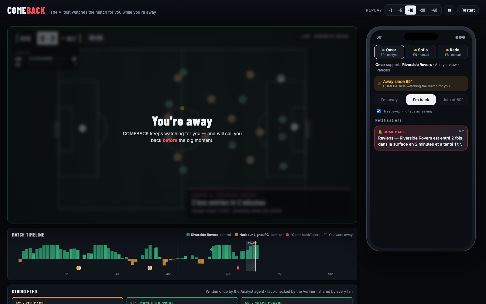
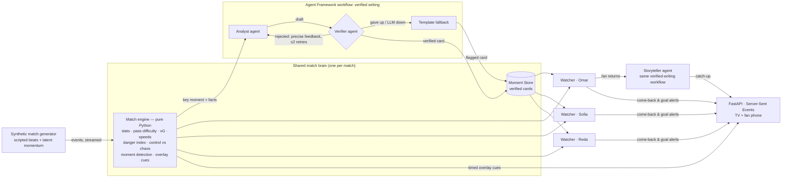

# COMEBACK

**The AI that watches the match for you while you're away.** It calls you back
*before* the big moment, and tells you what you missed when you return, in your
language, from your club's point of view, sized to how long you were gone.

[](https://codespaces.new/imaneoujja/comeback)


> Built for *Inside the Game: Developer Hackathon* (Microsoft × Premier League),
> challenge "Synthetic Match Insights Engine". All data is **synthetic**; all
> clubs and players are **fictional**.

---

## The insight

Every match app personalises on *preferences* (club, language, level). A fan's
real problem is **attention**. Nobody watches 90 minutes straight. You go to the
kitchen, answer a message, join at the 60th minute, or watch at 3 a.m. from
another time zone, and that is always when the goal comes.

COMEBACK personalises on **what you saw and what you missed**:

| | What happens | Example (demo match) |
|---|---|---|
| **1. You leave** | A Watcher agent keeps watching for you. It knows your club, favourite player, level and language. | Omar (Riverside Rovers fan, analyst, French) leaves at 65'. |
| **2. It's heating up** | It calls you back **before** the moment, and says why. | 67': *"Reviens — Riverside Rovers est entré 2 fois dans la surface en 2 minutes et a tenté 1 tir."* |
| **3. You return** | A "Previously on…" catch-up of what **changed**, sized to your absence (one line / key moments / full story). | 70': a 5-minute catch-up in French. The 71' goal arrives 30 seconds later. |



The same engine also covers the classic **live mode** for studio and streaming:
player tags, pass difficulty, shot speed, sprint speed, a danger meter, a momentum
timeline, and **timed, machine-readable overlay cues** that a broadcast graphics
renderer could consume.

## Try it (zero configuration, no API key)

**GitHub Codespaces:** click the badge above. The server starts by itself; open
the forwarded port **8000**.

**Locally** (Python ≥ 3.10):

```bash
git clone https://github.com/imaneoujja/comeback.git && cd comeback
python -m venv .venv && source .venv/bin/activate   # Windows: .venv\Scripts\activate
pip install -r requirements.txt
python -m comeback                                   # → http://localhost:8000
```

It runs **offline by default**. The demo match is precomputed, and its verified
LLM texts are committed in `data/llm_cache.jsonl`, so you see real model output
without any key.

### A 3-minute guided tour

1. Set the replay to **×20**.
2. **Reda** (Spanish, follows striker Elian Quarryn): pick his profile and press
   **Join at 60'**. You get the full story so far, centred on his player.
3. **Omar** (French, analyst, Rovers fan): pick his profile, press **I'm away**
   at about 65' (or just switch browser tab). Around 67' his phone gets a
   "come back" alert. Press **I'm back** at about 70'. Read the catch-up, then
   watch the 71' goal.
4. **Sofia** (English, casual, Harbour Lights fan): away at about 75', back at
   about 86'. Same match, a completely different story, told from the side that
   is losing its lead.
5. Watch the timeline: grey bands are absences, red dots are "come back" alerts.
   They land **before** the goals.

## How it works



### Agents, distinct roles, one shared state

| Agent | Input | Output | LLM? |
|---|---|---|---|
| **Analyst** | Compact computed facts of one key moment (never the raw event log), plus the match situation | Headline + "why it matters" (English, neutral), cited event ids | Yes |
| **Verifier** | A draft + the facts + the roster | Pass, or precise feedback for a retry | Rules (deterministic) |
| **Watcher** (one per fan) | The live danger index, the fan's presence and profile | "Come back" decision + reason, goal notifications | No: instant and free per fan |
| **Storyteller** | The verified cards of the away window, a "what changed" delta, the fan profile | Catch-up in the fan's language, level and point of view, sized to the absence | Yes |

- **Orchestration.** Analyst → Verifier → retry → fallback is a **Microsoft Agent
  Framework workflow** (`comeback/agents/workflow.py`) with typed executors and
  conditional edges. The *same* workflow serves the Storyteller. Nothing reaches
  a fan without passing the Verifier.
- **Shared state and handoffs.** The engine and the Moment Store are written once
  and read by every Watcher and by the Storyteller. A moment gets a template card
  instantly, so nobody waits for the LLM. The card is upgraded when the verified
  LLM card lands.
- **Recovery from failure.** Rate limit (429), timeout, network error, budget
  exhausted, invalid JSON, or three rejected drafts: each ends with a
  deterministic, fact-based template flagged `source: "template"`. Tests force
  every path.

### The Verifier earns its place

These are real errors from our first recordings with `gpt-4.1-mini` (plus one
our tests caught). Each one became a rule:

| The model wrote | Why it was wrong | Rule now enforced |
|---|---|---|
| "Rovers equalise *despite being a man down*" | Harbour Lights had the red card | A "ten men" claim must name the short-handed team |
| "*the fastest shot of the season*" | The facts only cover this match | No season, league, career or all-time claims |
| "*Kestrel almost extended the lead* for Riverside" | Riverside were trailing 1-2 (the bare score "1-2" was misread) | Every score handed to the agents is labelled with team names |
| "Kestrel scores his *9th*" (test case) | Invented: the 9 came from the player id `RVR-9` | Every number must exist in the facts; ids are not statistics |

The Verifier also rejects players who are not part of the moment, clubs outside
the match, and over-long texts. In the demo match, 2 of 20 texts were revised
after feedback. The UI shows it ("✓ Analyst → Verifier · revised 1×").

### Explaining *why*, not just *what*

- **Delta-based catch-ups.** The Storyteller gets the score and who was in
  control when you left and now, the players on the pitch, and the key changes
  (red card, shape change), and explains the difference rather than replaying a
  list of events.
- **Storylines detected by the engine** and handed to the agents as facts:
  redemption (a player scores after missing a big chance), the substitute's impact,
  comebacks from a two-goal deficit, minutes since the opponent's red card, and
  momentum swings (control = rolling possession × pass accuracy).

## Microsoft technologies

| Technology | Where |
|---|---|
| **Microsoft Agent Framework** (Python) | The LLM agents (Analyst, Storyteller) are `agent_framework.Agent`s. The verified-writing workflow is an Agent Framework `WorkflowBuilder` graph: writer, Verifier and fallback executors, conditional edges and a retry loop (`comeback/agents/workflow.py`, `llm.py`). |
| **Microsoft Foundry** | LLM inference: Azure OpenAI `gpt-4.1-mini`, Global Standard deployment, through Foundry's OpenAI-compatible v1 endpoint. 30k TPM cap and a daily call budget protect the credit. |
| **GitHub Codespaces** | One-click, zero-config environment for judges (`.devcontainer/`). |
| GitHub / GitHub Copilot | Development workflow. |

**Cost stays roughly constant as the number of fans grows.** You cannot make one
LLM call per fan per event when the audience is counted in hundreds of millions.
COMEBACK writes each key moment **once** (Analyst). Watchers are rule-based and
cost nothing per fan. Stories are generated per (moment set, language, level,
club) and cached. The whole demo match costs **22 LLM calls** (15 cards, 2
revisions, 5 stories), whatever the number of viewers.

## Data and match intelligence

**Synthetic data** (`comeback/synth/`) comes from a possession-based simulator:
passes with difficulty, carries, sprints, pressure, tackles, interceptions, fouls,
cards, penalties, shots with xG and speed, corners, throw-ins, goal kicks,
substitutions and stoppage time. It has six fictional clubs with distinct playing
styles and a latent "spells of dominance" process, because real matches come in
waves. Scripted scenarios inject story beats transparently: they are recorded in
the match metadata. Averages over 20 unscripted matches, checked by tests:

| Passes | Pass accuracy | Shots | xG | Goals | Possession range |
|---|---|---|---|---|---|
| 891 | 81% | 28.1 | 2.92 | 3.1 | 33–67% |

**Pass difficulty** (0–100): distance, pressure, forward ratio, final third and
long-ball terms; completion probability is a logistic of passing skill minus
difficulty. **xG**: logistic of distance and goal-mouth angle (headers penalised).
**Danger index** (0–100): exponentially decayed sum of box entries, final-third
passes, shots (10 + 40·xG), corners, high regains and successful pressure,
squashed with tanh.

### Does "come back" actually predict anything?

Measured with `python scripts/evaluate_alerts.py` on 50 **unscripted** synthetic
matches. Rule: danger ≥ 55, rising, not within 20 s of the team's own shot (that
chance is already over), 3-minute cooldown.

| Metric | Value |
|---|---|
| Alerts per team per match | 2.9 |
| Alert followed by a shot with xG ≥ 0.1 within 60 s | **23%** (chance baseline: 5%, **×4.7**) |
| Goals preceded by an alert for the scoring team (5-min window) | 26% |
| Median lead time before those goals | 38 s |

These are honest numbers on synthetic data. Validating them on real tracking data
is future work.

## Broadcast overlay API

`GET /api/overlays/demo-comeback?profile=omar` returns timed, renderer-agnostic cues:

```json
{"cue_id": "c00322", "t_in": 4431.0, "t_out": 4436.0, "layer": "top_right",
 "template": "shot_speed", "priority": 70, "audience": "all",
 "data": {"team": "RVR", "player": "RVR-9", "player_name": "Tavi Kestrel",
          "shot_speed_kmh": 119.8, "xg": 0.336, "outcome": "goal"}}
```

Templates: `player_tag`, `pass_quality`, `shot_speed`, `sprint`, `danger`,
`moment`. Each cue targets `all`, `analyst` or `casual` viewers.

Other endpoints: `GET /api/stream` (Server-Sent Events: events, snapshots, cues,
cards, alerts, catch-ups), `POST /api/session/{id}/away | back | join?minute=60 |
speed | pause | profile`, `GET /api/match/{id}`, `GET /api/profiles`.

## Run with your own Foundry deployment (optional)

```bash
cp .env.example .env    # set FOUNDRY_ENDPOINT, FOUNDRY_API_KEY, FOUNDRY_MODEL
LLM_MODE=live python -m comeback                 # any absence gets a freshly written story
LLM_MODE=record python scripts/precompute.py     # re-record the demo cache
```

## Development

```bash
pytest                        # 41 tests: realism, engine, verifier, workflow paths, watcher, API
ruff check .
python -m comeback.synth.cli random --count 5    # more synthetic matches
python scripts/evaluate_alerts.py
```

```
comeback/
  synth/    teams, simulator, scenarios, CLI      (synthetic data)
  engine/   state, passes, xg, danger, moments, overlays, alerts, match
  agents/   llm (Foundry gateway), workflow, analyst, verifier, storyteller,
            watcher, templates, brain (shared state)
  fans/     profiles, session, catch-up selection
  api/      FastAPI server, replay sessions (SSE)
web/        vanilla JS client: canvas pitch, overlays, timeline, phone
scripts/    precompute.py, evaluate_alerts.py, hello_agent.py
data/       demo match, profiles, committed LLM cache
```

## Limits and next steps

- Synthetic data only; alert quality must be validated on real data.
- Offline mode serves cached stories for the demo's absences; other windows get
  the (verified) template text unless `LLM_MODE=live`.
- Next: an MCP server so any agent (or GitHub Copilot) can query the live match,
  more languages, and push notifications on a real phone.

## License

MIT. See [LICENSE](LICENSE). No real clubs, players, leagues, logos or
broadcasters are used or implied.
